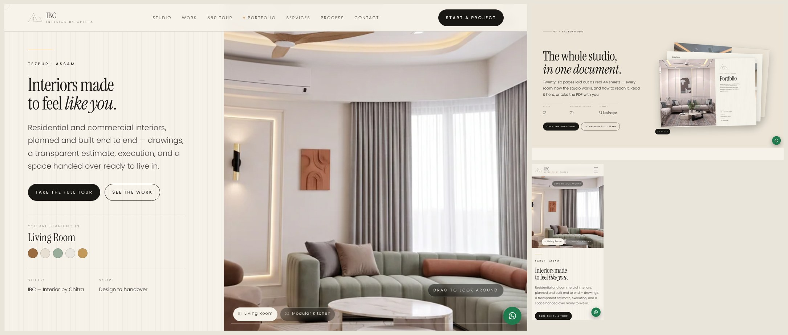

# IBC — Interior by Chitra · Website

A static, single-page website for **IBC — Interior by Chitra**, an interior design studio in
Tezpur, Assam, founded by Chitra Ranjan Neog.

Plain HTML, CSS and vanilla JavaScript. No build step, no frameworks, no CDN calls. Everything —
fonts, scripts, images, video — is served from this folder, so the site works on GitHub Pages,
on any shared host, and by double-clicking `index.html` straight off the disk.



---

## 1. Features

| Section | What it does |
|---|---|
| Hero | **A live, draggable 360° of a finished room.** The visitor is standing inside the work from the first second; room chips along the bottom switch which room they are in. Headline rises line by line, two CTAs, hairline frame, film grain and a scroll cue. Falls back to a still image when JavaScript is off |
| Marquee | Continuous strip of the studio's services |
| 01 The Studio | Studio intro with an asymmetric image pair and four verified facts |
| 02 Selected Work | 70 images in seven **folder cards** — Living Room 15 · Modular Kitchen 18 · Bathrooms 12 · Bedrooms 2 · Wardrobes 8 · Shelving 4 · Ongoing Work 11. Each card is a stack of photographs; clicking opens that folder as a **full-screen page** that slides up over the site, with the page behind locked. "All folders" closes it and returns you to the exact scroll position you left. Keyboard accessible, Escape closes. Lightbox works inside |
| 04 Step Inside | **The 360° room tour** — two rooms, drag to look around (see §3), plus a companion bathroom walkthrough video |
| 05 Services | Accordion of the five services, with a hover preview image on desktop |
| 06 Process | The studio's own five-stage process |
| 07 On Site | Eight walkthrough reels, MP4 + WebM, played only when scrolled into view (see §14) |
| 03 The portfolio | A section of its own on the home page: a fanned stack of three real sheets from the document, the page count, and two buttons — open `portfolio.html`, or download the PDF. It sits straight after Selected Work, because the moment someone has finished looking at rooms is the moment to hand them the whole thing |
| 08 Contact | Enquiry form that opens WhatsApp or email with the message pre-written |
| Everywhere | Sticky header that hides on scroll-down, full-screen mobile menu, floating WhatsApp button, custom cursor on desktop, preloader that skips on repeat visits, 404 page |

Accessibility: skip link, visible focus rings, ARIA on the tabs/accordion/dialog/viewer, full keyboard
support, alt text on every image, touch targets of at least 36 px, and `prefers-reduced-motion`
honoured throughout (animations stop, videos do not autoplay).

---

## 2. Running it

**Double-click `index.html`.** That is the whole thing — it works from `file://`.

To run a local server instead (closer to production, and it lets the 360 tour use WebGL):

```bash
cd IBC_Premium_Website
python3 -m http.server 8080
# then open http://localhost:8080
```

---

## 3. The 360° room tour

The three panoramas are **real photographs of Chitra's finished projects**, not AI images and not
renders. Each one was assembled from the studio's own phone walkthrough footage: every frame is
warped into cylindrical coordinates, the camera rotation between frames is measured, and a thin
vertical slice from the centre of each frame is laid down side by side. Taking only the centre slice
is what stops the operator's walking from causing ghosting.

| Room | Coverage | Resolution | Source |
|---|---|---|---|
| Living Room | full 360° | 4096 x 900 | Generated from the studio's own renders, two halves joined |
| Modular Kitchen | full 360° | 4096 x 900 | Generated from the studio's own renders, two halves joined |

**These two panoramas are design visualisations, not photographs.** Both depict rooms the studio
had already designed and rendered — they were generated from a written specification of the client's
own render set, so they show his design work, not invented spaces. Each was generated as two
ultra-wide 4K halves from a written specification of one of the studio's own rendered rooms, then
joined. Both halves were made so their open edges show the same feature — the fluted oak wall for
the living room, the rose-gold tree screen for the kitchen — so the joined strip closes into a true
loop. Two seams are blended: the centre join between the halves, and the wrap seam where the right
end meets the left. `assets/../join360.py` in the build notes documents the method.

Panoramas are capped at 4096px wide so they stay inside the texture limit of mobile GPUs, with a
1600px preview that loads first.

The studio's real photographed rooms are in *Selected work* and *On site* — the 360 is the polished
visualisation layer, and the page labels it as such.

Rooms under a full turn stop at the ends of their sweep instead of wrapping, and auto-rotate
reverses rather than jumping.

**Three renderers, picked automatically:**

1. **WebGL** — a textured cylinder. Used over `http://` and `https://`.
2. **Canvas 3D** — re-projects the panorama into a true perspective view, one thin vertical strip
   at a time with plain `drawImage`. Used on `file://`, or if WebGL is unavailable or a texture
   upload fails. Geometrically identical to the WebGL view.
3. **Flat** — a scrollable strip. Last resort.

Why the fallback matters: a browser will not let WebGL read an image loaded from `file://`, so
opening the page off the disk *always* uses the canvas renderer. This is deliberate, not a bug.
The canvas renderer never reads pixels back off the canvas, which is what would otherwise trip the
same `file://` security rule.

Force a renderer for testing by adding `?pano=webgl`, `?pano=canvas` or `?pano=flat` to the URL
(`?pano=css` still works and maps to the canvas renderer).

**Controls:** drag or swipe (the room follows your finger), pinch or ctrl+scroll to zoom, arrow keys,
auto-rotate toggle, full screen (with a pseudo-fullscreen fallback for iPhone Safari), room tabs, and
material chips that swing the view round to that material.

---

## 4. File structure

```
index.html              the whole site
portfolio.html          the 70-image portfolio document, 26 A4 sheets
IBC-Interior-by-Chitra-Portfolio.pdf    what the Download PDF button serves
404.html                not-found page
preview.jpg             desktop + portfolio + mobile collage
robots.txt  sitemap.xml  site.webmanifest
.nojekyll               tells GitHub Pages to serve files starting with _
assets/
  css/main.css          the site
  css/portfolio.css     the A4 sheets, on screen and in print
  js/main.js            site behaviour
  js/pano.js            the 360 viewer (no dependencies)
  fonts/                Instrument Serif + Poppins, subset, with OFL licences
  icons/                favicon.svg, favicon-32, apple-touch-icon, icon-192, icon-512
  img/
    logo-mark.png       the studio's own logo, keyed to transparency
    logo-lockup.png     logo with wordmark
    og-image.jpg        social share card
    work/<room>/        70 images in 7 room folders (full + -sm variants)
    print/              JPEG copies of the same images, used only to build the PDF
    pano/               3 panoramas (full + -preview)
    studio/             founder portrait
  video/                4 reels as MP4 + WebM, each with a WebP poster
tools/                  scripts that rebuild the portfolio, the PDF and the test matrix
```

---

## 5. Deploying to GitHub Pages

1. Create a repository and push this folder's contents to the `main` branch.
2. Repository → **Settings** → **Pages**.
3. Source: **Deploy from a branch**, branch `main`, folder `/ (root)`. Save.
4. The site appears at `https://<username>.github.io/<repo>/` within a minute or two.

For a custom domain, add it under Settings → Pages → Custom domain, then update the URLs in §7.

---

## 6. Where to edit content

**Contact details** appear in several places. Search `index.html` for each and change all matches:

- Phone `9365333187` — the `tel:` links, the JSON-LD block and the footer
- WhatsApp `919365333187` — the floating button's `wa.me` link, and `PHONE` near the top of
  `assets/js/main.js` (the form uses that one)
- Email `Chitraranjanneog38@gmail.com` — the `mailto:` links, the JSON-LD, and `EMAIL` in `main.js`
- Instagram / Facebook / Maps links — header menu, contact block, footer, JSON-LD

**Folders.** The work section is built from folder cards. The markup is a
`.fgrid` of `.fcard` buttons plus a hidden `.fopen` panel containing one `.fbody` per folder;
`assets/js/main.js` toggles them and restores the scroll position on close. Adding a category means
adding a card and a matching `.fbody`.

**Portfolio.** Drop a new image into `assets/img/work/` as `slug.webp` (about 1600 px on the long
edge) plus a `slug-sm.webp` (about 760 px), then copy an existing `<figure class="work__item">`
block in the Selected Work section and change the paths, `data-cat`, `data-title` and alt text.
`data-cat` must be one of `Kitchens`, `Bathrooms`, `Storage`, `Ceilings`, `Living` to match the
filter buttons.

Two build-stage photographs ship in `assets/img/work/` but are **not** on the page —
`wardrobe-bench-niche` and `kitchen-build-in-progress`. They show joinery mid-assembly rather than a
finished room, so they were kept out of the portfolio. Add them the same way if you want to show the
making of a project.

**360 rooms.** The viewer reads `window.IBC_ROOMS`, the small script block just before the closing
`</body>`. Each entry needs `src`, `preview`, `w`, `h`, `hfov` (horizontal degrees the image covers),
`vfov`, `startYaw` (which way the room faces when it opens) and its `materials`.

The viewer is a reusable module: `IBCPano(sectionEl, opts)` in `assets/js/pano.js`. Two instances
run on the page — one in the hero, one in the tour section — each with its own renderer and state.
`opts.hero` marks the hero instance and `opts.spinSpeed` sets its drift rate. Getting `hfov` right matters — it is what makes dragging feel 1:1. To add
a room you need a new cylindrical panorama; ordinary photographs will not work.

**Colours.** All of them are CSS variables at the top of `assets/css/main.css`:

```css
--ivory  #f6f2ea   --bone   #ebe4d7   --sage   #b9baac
--walnut #7c5334   --brass  #c2995b   --ink    #1a1815   --petrol #2c4e5c
```

The palette is taken from Chitra's own work and his logo — the sage is the background colour of the
IBC logo, the petrol blue is the kitchen in the first panorama, and the brass matches his cove
lighting.

**Typography.** Instrument Serif for display, Poppins for everything else, both self-hosted in
`assets/fonts/` with their SIL Open Font Licence files. They are shipped as `.woff` rather than
`.woff2`; every current browser supports WOFF, the files are just slightly larger. If you want
WOFF2, re-subset the originals with `fonttools` on a machine that has the Brotli extension and
update the `@font-face` blocks.

---

## 7. Before launch

- [ ] **Confirm the domain.** Every URL currently points at `https://ibcinterior.in` — taken from
      the old site in the video. If the domain has lapsed or changes, update it in `index.html`
      (`<link rel="canonical">`, the `og:` and `twitter:` tags, and the JSON-LD `url` and `image`),
      `robots.txt` and `sitemap.xml`. `og:image` must stay an **absolute** URL or previews break.
- [ ] **Add the street address and opening hours.** The JSON-LD currently carries only
      Tezpur / Assam / IN, because no verified street address or hours were available. Add
      `streetAddress`, `postalCode` and `openingHoursSpecification` once confirmed.
- [ ] Check the *Concepts* images are ones the studio is happy to publish; they are labelled
      "design visualisation" so nobody mistakes them for finished rooms.
- [ ] If Chitra can supply unwatermarked reel footage, re-cut the four videos; two currently carry
      his own "INTERIOR BY CHITRA" watermark, which was left in place deliberately.
- [ ] **Ask for clean copies of the watermarked renders.** Several renders have
      "INTERIOR BY CHITRA" burnt across the middle. Three of them he had also sent clean, and
      those clean copies are the ones used. See `IBC_Images_To_Fix/` for the rest.
- [ ] Submit `sitemap.xml` in Google Search Console and claim the Google Business Profile.

---

## 8. Portfolio organisation

The client sent 94 files across two packs. Every one of them has exactly one destination, and the
build asserts that — if a file is ever added or renamed and goes unaccounted for, `build_assets.py`
stops rather than quietly dropping it.

| | Count |
|---|---:|
| Used on the site | 70 |
| Held back — needs a re-shoot or is not a portfolio image | 13 |
| Duplicates the client sent twice | 7 |
| Superseded by a higher-resolution copy of the same photo | 4 |
| **Total** | **94** |

The 20 files not used are packaged in `IBC_Images_To_Fix/`, each with a one-line reason. Nothing was
deleted; any of it can go back in.

The 70 that are used are organised into room folders under `assets/img/work/`, and the folder
cards on the site match that structure exactly:

| Folder | Count | Contents |
|---|---:|---|
| Living Room | 15 | Seating, media walls, feature stone and layered ceilings |
| Modular Kitchen | 18 | Modular runs, marble counters, islands and breakfast bars |
| Bathrooms | 12 | Vanities, backlit mirrors, stone and walk-in showers |
| Bedrooms | 2 | Bedroom schemes with fitted storage and panelling |
| Wardrobes | 8 | Fitted wardrobes, tall units and study desks |
| Shelving | 4 | Open joinery, display niches and bench seating |
| Ongoing Work | 11 | Joinery photographed during execution |

Living Room and Modular Kitchen are deliberately separate folders. Execution-stage photographs stay
in *Ongoing Work* so that unfinished joinery is never mixed in with finished interiors; every tile
in it carries an **On site** badge. Design drawings are deliberately **not** badged: they are the
studio'''s own drawings for its own schemes, and labelling each one turned the page into a list of
caveats. The 360 panoramas are a separate matter and are still labelled *design visualisations*,
because those were AI-generated rather than drawn by the studio.

## 9. The bathroom walkthrough

The short clip in *Step inside* was generated from one of the studio's own site photographs of a
marble bathroom, so the room shown is one that was actually built. It carried a visible Gemini
sparkle watermark in the lower right; the video is cropped from 1080x1920 to 1080x1690 before
encoding, which removes it cleanly without blurring or painting over anything — and takes some of
the plastic sheeting on the floor with it.

Two things to be aware of before publishing:

- Google embeds an invisible **SynthID** marker in its generated video. Cropping the visible
  watermark does not remove that, and it is not something to try to strip.
- Check Google's current terms for the tool that produced the clip, in case they require the
  visible mark to be retained. That is a call for you and the client, not something I can decide.

The clip is labelled "Animated from a site photograph" on the page.

## 10. A note on image metadata

The panorama source files Runway produced carry IPTC and XMP metadata identifying them as AI
generated. Re-encoding them to WebP for the web dropped that metadata, so the shipped files no
longer carry it — a side effect of the conversion, not a deliberate removal. The disclosure that
matters is on the page itself: both panoramas are labelled as visualisations in the hero, on the
viewer, and in the tour copy. Keep the original PNGs if you want the provenance preserved.

## 11. Honesty notes

Everything on this site is real, and the few things that are not photographs say so:

- The **360 panoramas** are genuine photographs of completed IBC projects, rebuilt from the studio's
  own walkthrough video. Nothing is AI-generated.
- The two **360 panoramas** are generated visualisations of rooms from the studio's own render set.
  They are labelled as visualisations in three places on the page.
- The **testimonials section was removed** at the client's request rather than carry paraphrased quotes.
- The **logo** is the studio's real logo, extracted from its own artwork; the favicon is a
  simplified redraw of the same gable mark.
- The **founder portrait** is Chitra's own photograph, converted to a warm duotone so it sits with
  the rest of the page. No features were altered.
- No awards, project counts, years-in-business or client names have been invented anywhere.

---

## 12. Testing done

`test_matrix.py` runs Playwright / Chromium over **both pages** — `index.html` and
`portfolio.html` — against a local HTTP server **and** `file://`, at every size in the brief:

**Desktop / laptop:** 1920×1080 · 1440×900 · 1366×768
**Tablet:** iPad landscape 1180×820 · iPad portrait 820×1180 · 768×1024
**Phone:** 390×844 · 360×780 · 844×390 landscape

At each size it checks: no horizontal overflow (and names the offending element if there is any),
no page errors, no console errors, no reveal element left invisible after a fast scroll to the
bottom and back, no broken images, the hero drag surface actually on top and hittable, a folder
that opens and returns to the **exact** scroll position, an empty contact form that fails
validation, a live `wa.me` link, 26 portfolio sheets, a PDF link that points at a file that exists,
and no sheet wider than the viewport.

Then the three special modes at desktop and phone: `prefers-reduced-motion`, WebGL disabled, and
JavaScript disabled.

Result: **0 failures, 42 page-checks.** Three real bugs were found and fixed by this run —

1. Scroll reveals only un-hid what was on screen at that moment, so a fast flick or an `#anchor`
   jump left whole sections permanently invisible. The sweep now reveals everything at or above
   the fold, including what has been scrolled past.
2. The portfolio sheets were shrunk with `transform: scale()`, which changes only how an element
   is painted — it still occupied its full 1122px in the layout, so every phone and tablet had a
   horizontal scrollbar. They now use `zoom`, which changes the layout box too.
3. The **Download PDF** button was ink-on-ink and therefore invisible: a neighbouring
   `.pf-bar__nav a { color: inherit }` rule outranked it on specificity.

A separate visual pass screenshots the viewer at all sizes, in both renderers and each room, and
measures the rendered pixels — dead columns, black area, overall brightness — so a viewer that
loads but renders wrongly cannot pass. Every page of the generated PDF was also rendered to an
image and looked at.

**Not tested:** real iPhone/iPad Safari, real Android Chrome, and actual hardware GPUs — all of the
above ran in headless Chromium on Linux. The iOS pseudo-fullscreen path and pinch-zoom in
particular are worth a quick check on a real phone before you show the client. Printing from
Safari's own print dialog is also untested; the download is a pre-made PDF, so it is unaffected.

---

## 13. The portfolio page and PDF

`portfolio.html` is a separate 26-sheet document. Each sheet is a **true A4 landscape page**
(297 × 210 mm) — not a web page that happens to print, but the printed page itself, shown on
screen. That is why what the visitor scrolls and what the PDF prints cannot drift apart.

Running order: cover · the studio · services · process · then, for each room, a full-bleed divider
followed by six-up image grids · contact.

**The download.** `IBC-Interior-by-Chitra-Portfolio.pdf` sits next to the page and the toolbar
button links straight to it. It is 11 MB, which sends over WhatsApp without complaint.

**To regenerate it after changing anything:**

```bash
cd tools
python3 build_portfolio.py    # rebuilds portfolio.html from manifest.json
python3 make_pdf.py           # prints that page to PDF
```

(Needs `pip install playwright pillow` and `playwright install chromium` once. The scripts find
the site folder relative to themselves, so they work wherever you put the project.)

`make_pdf.py` does two things that matter. It forces every image to load before printing —
`loading="lazy"` otherwise prints empty boxes for every page that never scrolled into view. And it
swaps each image for a JPEG copy from `assets/img/print/` first: Chromium re-encodes WebP into a
PDF **losslessly**, which produced a 163 MB file, while it passes JPEG data straight through. Same
pages, same on-page resolution, a fourteenth of the size.

---

## 14. The client's videos

He sent **30 videos** in the October pack. The site uses **nine** of them in total:

- **Four** were cut from the October pack into the *On Site* reels — a living room, a study
  desk, a wardrobe run and a modular kitchen. Before these, the reels were three bathrooms, a
  pantry and a kitchen, and nothing from that pack was on the site at all.
- **Four** older reels and **one** bathroom walkthrough (in *Step Inside*) came from his earlier
  pack and were already there.

The other 26 are not used, for reasons that are worth knowing if he asks:

- several have a person in frame, usually filming themselves in a mirror;
- several are a few seconds long, or a close-up pan across a texture with no room in it;
- the green-kitchen set is eight clips of the same kitchen;
- the rest are site-stage footage with debris on the floor.

**Every one of these clips is a hand-held phone pan**, and each wanders onto a blank cupboard
face or a pile of site rubbish somewhere. So each of the four was cut from a window chosen off a
one-frame-per-second filmstrip of the whole clip — `tools/add_reels.py` records the exact
in-point and length, and the reason, per clip. Two of them are the same flat, cut to show
different things.

To add more, put the start second and length in that file's `CLIPS` list and run it. It crops to
the 540×720 the other reels use, strips the audio, and writes MP4 (H.264, faststart) + WebM (VP9)
with a WebP poster taken from the middle of the cut.

If he can send the originals rather than WhatsApp copies, they are worth re-cutting: everything
here arrived at 464×832 or 1024×576, which is why the reels are soft at full width.
